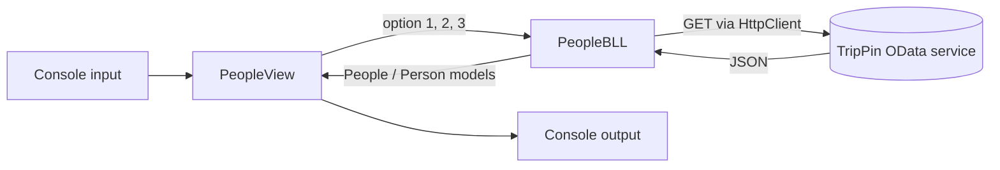

# .NET OData People Client

A small .NET 10 console application that browses the people in Microsoft's public
TripPin OData sample service. It sends three kinds of OData request, maps the JSON
responses into typed C# models with `System.Net.Http.Json`, and prints them as a
plain-text report.

It is a compact example of a layered HTTP client: the request building, the console
interaction and the models are separate, and the HTTP layer can be swapped for a fake
in tests.

## What it does

The menu offers three operations:

1. **Show People**: list the TripPin `People` collection.
2. **Search People**: filter by exact first name with an OData `$filter` query.
3. **Show Details of Specific Person**: fetch one person by username, including
   gender, features and addresses.

| Menu option | Request sent |
| --- | --- |
| 1 | `GET https://services.odata.org/TripPinRESTierService/People` |
| 2 | `GET .../People?$filter=FirstName%20eq%20%27Russell%27` |
| 3 | `GET .../People(%27russellwhyte%27)` |

The collection response is mapped from the OData `value` array into `People.Value`;
a single-person response maps directly into `Person`.



## Example session

The sessions below use the sample records from the test suite (served by a fake HTTP
handler), so they don't depend on the live service's data.

Listing people (option 1):

```text
Please select from below
1-Show People
2-Search People
3-Show Details of Specific Person
Press 1,2 or 3 from Above...
1
User Name : russellwhyte
	Name : Russell Whyte
	Age : 
	Email : Russell@example.com, Russell@contoso.com
User Name : scottketchum
	Name : Scott Ketchum
	Age : 
	Email : Scott@example.com
```

Person details (option 3):

```text
Press 1,2 or 3 from Above...
3
Enter User Name : russellwhyte
User Name : russellwhyte
	Name : Russell Whyte
	Age : 42
	Email : Russell@example.com
	Gender : Male
	Favourite Feature : Feature1
	Features : Feature1, Feature2
	Address : 187 Suffolk Ln.
	Home Address : 1 Home Rd.
```

Unknown usernames and empty searches print `No Record Found`. If the service can't be
reached, the client reports it and exits, for example:

```text
Request failed: TripPin returned 503 Service Unavailable
```

## Run it

The application runs one menu action per start and needs internet access to reach
`services.odata.org`.

### With Docker

```bash
docker build -t trippin-people .
docker run --rm -it trippin-people
```

The image is built with `mcr.microsoft.com/dotnet/sdk:10.0` and runs on
`mcr.microsoft.com/dotnet/runtime:10.0` as a non-root user. `-it` is required because
the menu reads from standard input.

### With the .NET SDK

Install the .NET 10 SDK (`global.json` pins `10.0.x`), then from the repository root:

```bash
dotnet run --project dotnet-test-project.csproj
```

## Tests

```bash
dotnet test --solution dotnet-test-project.sln
```

The xUnit v3 project in `tests/dotnet-test-project.Tests` has 19 tests. A fake
`HttpMessageHandler` returns canned TripPin JSON, so the tests never call the real
service and run offline. They cover:

- the exact URLs, `$filter` expression and `Accept` header the client sends;
- escaping of quotes and reserved characters in names;
- mapping of the OData payload, including `null` ages and missing lists;
- 404 handling for unknown usernames and the error text for server failures;
- every menu path, including invalid input and end of input.

`global.json` selects Microsoft.Testing.Platform as the test runner, which the .NET 10
SDK requires for xUnit v3.

## Design notes

- **Injected `HttpClient`.** `ApiHelper.CreateClient` builds one client with the
  TripPin base address, a JSON `Accept` header and a 30-second timeout. `PeopleBLL`
  receives it through its constructor, which is what lets tests pass in a fake handler.
- **Safe OData literals.** User input is wrapped as an OData string literal (single
  quotes doubled) and then URL-encoded, so names like `O'Neil` or text containing `&`
  can't change the query.
- **Focused error handling.** Only expected failures are caught: HTTP errors (shown
  with their status code), timeouts and malformed JSON. A 404 for a username is treated
  as "no record", not as an error.
- **Testable console.** `PeopleView` reads and writes through a `TextReader` and
  `TextWriter`. `Program` passes `Console.In` and `Console.Out`.
- **No third-party runtime packages.** JSON handling uses the in-box
  `System.Net.Http.Json`.

## Project structure

```text
Api/ApiHelper.cs        # Builds the configured HttpClient for TripPin
BLL/PeopleBLL.cs        # OData requests, literal escaping, menu validation
Models/                 # Person, People collection, Location and City contracts
View/PeopleView.cs      # Menu, prompts and formatted output
Program.cs              # Wires the client, BLL and view to the console
tests/                  # xUnit v3 tests with a fake HTTP handler
Dockerfile              # Two-stage build and runtime image
global.json             # SDK and test-runner pin
```

## Limitations

- TripPin is a public demo service. Its availability and sample data can change.
- Each run performs a single menu action and then exits.
- If the service pages its results, only the first page is shown; `@odata.nextLink`
  is not followed.

## License

MIT, see [LICENSE](LICENSE).
